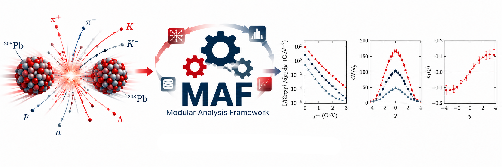

<p align="center">
  
</p>

# MAF — Modular Analysis Framework

MAF computes observables from event-by-event SMASH–vHLLE simulations stored
in OSCAR2013 or OSCAR2013Extended format. A configuration file defines the
inputs, particle selections and calculations. Outputs include numerical
tables, statistical uncertainties and plots.

Available observables include pT and mT spectra, dN/dy, dNch/dη,
net-proton dN/dy, yields, mean values, particle ratios and flow vₙ using
the reaction-plane, event-plane and two- or four-particle Q-cumulant methods.

## Installation

From the `MAF` project directory, using Python 3.9 or later:

```bash
python3 -m venv venv
source venv/bin/activate
python3 -m pip install -e '.[plot,yaml,flow]'
maf --version
```

This installs NumPy, YAML support, Matplotlib for plotting and SciPy for
event-plane resolution. The `maf` command is available while the virtual
environment is active. The `-e` option uses the source files directly, so
Python code changes take effect without reinstalling the package.

After logging in again, return to the project directory and activate the
environment:

```bash
source venv/bin/activate
```

## Configuration and analysis

Edit [analysis.yaml](analysis.yaml) to set:

- `input`: the directory containing simulation runs;
- `run_pattern`: a glob filter for run directory names;
- `output`: the output directory;
- `observables`: calculations, cuts and `enabled: true/false` switches.

Example configuration for independent events from one physical production:

```yaml
input: /path/to/simulations
output: "results_{run_pattern}/"
run_pattern: "run_*"
workers: 1
group_by: []
sampling:
  mode: event

observables:
  dndy:
    enabled: true
    pdg: [211, -211, 2212]
    y_bins: {min: -2, max: 2, count: 40}
```

`group_by: []` combines all selected files into one ensemble. The filter
must therefore select the same energy, parameters and physical event
selection. Each file is read once, and all enabled observables receive its
events. Contributions are normalized after aggregation over the ensemble.
For repeated afterburner samples of the same hydro event, configure the
appropriate [sampling hierarchy](docs/physics.md).

First validate the configuration and inspect the selected inputs, then
run the analysis:

```bash
maf --config analysis.yaml --dry-run
maf --config analysis.yaml
```

Relative paths are resolved against the configuration file. `workers`
controls how many inputs are processed concurrently. Repeated analyses
reuse valid cached contributions; `--no-resume` forces recomputation.
During analysis, progress reports show completed/total files, the percentage,
newly analyzed files, cache hits, failures and elapsed seconds. Parallel
workers share one progress report from the main process. Progress and errors
go to stderr; dry-run and discovery JSON stay on stdout.

`maf run --config analysis.yaml` is the explicit form of
`maf --config analysis.yaml`. Both use the same command-line parser.
List all commands and inspect their options with:

```bash
maf --help
maf run --help
maf plot --help
```

You can also run `python -m maf` or `python main.py` with the same arguments.

A numeric list such as `pdg: [211, -211, 2212]` produces a separate result
for each species. `pdg: [all_charged]` produces one combined result for
all charged species. Omitting `pdg` includes neutral species as well;
`dndeta` and `charged_multiplicity` always select charged particles.

## Plotting

Plot every calculated observable and particle species:

```bash
maf plot --all --config analysis.yaml
```

Create PDFs or plot a single observable:

```bash
maf plot --all --config analysis.yaml --format pdf
maf plot --config analysis.yaml --observable dndy_2212 --output proton_dndy.png
```

Plots use saved DAT values, quantities and units; plotting does not rerun
the analysis. Legends identify the simulation using its saved `run_pattern`.
For older outputs, plotting with `--config` uses that configuration's pattern;
explicit result inputs fall back to their result directory label.
Set the appearance under `plot.rc_params` in the
configuration. Spectra automatically use a logarithmic y axis when they
contain positive values. On a machine without a graphical display, use:

```bash
MPLBACKEND=Agg maf plot --all --config analysis.yaml
```

## Output structure

With `output: "results_{run_pattern}/"`, the output layout is:

```text
results_<run_pattern>/
├── index.json                  current result groups
├── failures.json               failed runs; [] after a successful analysis
├── results/
│   ├── summary.json            values, errors, covariance and metadata
│   ├── accumulators.npz        raw contributions for resuming and merging
│   ├── dndy_211.dat
│   └── dndy_2212.dat            one DAT table per result
├── plots/                      PNG or PDF files created by the plot command
└── cache/                      intermediate contributions from each input
```

When `group_by` produces multiple groups, results are stored under
`results/group-<id>/`; batch plotting also creates separate plot
subdirectories. DAT columns contain the coordinate, lower and upper bin
edges, value and statistical error. Headers record quantities, units and
the calculation definition. See the [result format](docs/results.md).

## Code structure

```text
MAF/
├── main.py                     entry point from the source directory
├── analysis.yaml               user configuration
├── pyproject.toml              packaging and dependencies
├── src/maf/
│   ├── main.py                 load the job and start the analysis
│   ├── config.py               expand observable configurations
│   ├── analysis.py             stream events, cache and aggregate
│   ├── cli.py                  plot, discover, analyze, merge, compare
│   ├── core/                   particles, events and selections
│   ├── io/                     OSCAR, configuration, metadata and DAT
│   ├── observables/            small calculation functions
│   ├── statistics/             accumulators, jackknife and covariance
│   ├── plotting/               plots from saved results
│   └── experiment/             experimental tables and comparison
├── docs/                       observable definitions and guides
├── examples/                   example configurations and synthetic data
└── tests/                      numerical and integration tests
```

Individual calculations are plain NumPy functions. Shared code handles
reading, selections, statistics and export; see the
[calculation module guide](docs/simple-modules.md).

## Observable documentation

| Area | Document |
|---|---|
| pT and mT spectra | [pt-spectra.md](docs/pt-spectra.md) |
| dN/dy, dNch/dη and net protons | [rapidity.md](docs/rapidity.md) |
| yields, mean values and ratios | [yields-means-ratios.md](docs/yields-means-ratios.md) |
| RP and EP flow versus y, η and pT | [flow.md](docs/flow.md) |
| two- and four-particle Q cumulants | [q-cumulants.md](docs/q-cumulants.md) |

Additional guides cover [configuration](docs/configuration.md),
[physics and statistics](docs/physics.md), [results](docs/results.md)
and [validation](docs/validation.md).
The full documentation index is [docs/README.md](docs/README.md).

## License and citation

MAF is released under the [MIT License](LICENSE). If you use MAF in research,
cite the repository and the software version used. Machine-readable citation
metadata are available in [CITATION.cff](CITATION.cff).
